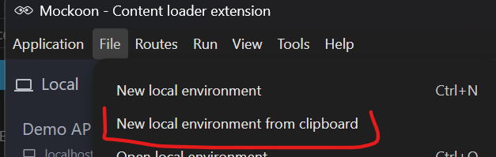

# Content Loader Extended

Extension to improve how ThingWorx can consume external REST APIs, adding functionality missing from
the OOTB `Resources.ContentLoaderFunctions`.

## Usage

The extension exposes a new ThingWorx Resource called `ContentLoaderExtended`.

The core service this exposes is `ExecuteHttpRequest`. This service can be used to execute a request
of any type to a server. The HTTP verb can be specified using a service parameter.

Here are the parameters the service accepts:

| Name                | Description                                                                              | BaseType |
|:--------------------|:-----------------------------------------------------------------------------------------|:---------|
| url                 | URL to load                                                                              | STRING   |
| method              | HTTP method to use                                                                       | STRING   |
| content             | Payload that should be sent to the endpoint. Only some methods support setting a payload | STRING   |
| contentType         | ContentType of the payload to use. Must be specified if content is specified             | STRING   |
| username            | Optional user name credential                                                            | STRING   |
| password            | Optional password credential                                                             | STRING   |
| headers             | Optional HTTP headers                                                                    | JSON     |
| ignoreSSLErrors     | Ignore SSL Certificate Errors                                                            | BOOLEAN  |
| withCookies         | Include cookies in response                                                              | BOOLEAN  |
| withResponseStatus  | Include response status                                                                  | BOOLEAN  |
| withResponseHeaders | Include response headers                                                                 | BOOLEAN  |
| timeout             | Optional timeout in seconds                                                              | NUMBER   |
| useNTLM             | Use NTLM Authentication                                                                  | BOOLEAN  |
| workstation         | Auth workstation                                                                         | STRING   |
| domain              | Auth domain                                                                              | STRING   |
| useProxy            | Use Proxy server                                                                         | BOOLEAN  |
| proxyHost           | Proxy host                                                                               | STRING   |
| proxyPort           | Proxy port                                                                               | INTEGER  |
| proxyScheme         | Proxy scheme                                                                             | STRING   |
| keyStorePath        | Absolute path to the client SSL keystore                                                 | STRING   |
| keyStorePassword    | SSL Keystore Password                                                                    | STRING   |
| trustStorePath      | Absolute path to the SSL client truststore                                               | STRING   |
| trustStorePassword  | SSL Truststore Password                                                                  | STRING   |

Usage examples:

- Executing a GET request:

```javascript
let result = Resources.ContentLoaderExtended.ExecuteHttpRequest(
    {
      url: url,
      withResponseStatus: true,
      method: "GET",
      headers: {
        Prefer: "odata.maxpagesize=100",
        Accept: "application/json;odata.metadata=full",
      },
      ignoreSSLErrors: true,
      password: "test",
      username: "test"
    },
);
```

- Executing a PATCH request with body and mutual SSL auth:

```javascript
let result = Resources.ContentLoaderExtended.ExecuteHttpRequest(
    {
      url: url,
      withResponseStatus: true,
      method: "PATCH",
      contentType: "application/json",
      content: JSON.stringify({prop: "Value"}),
      headers: {
        ContentType: "application/json",
        CSRF_NONCE: me.csrfNonce,
      },
      ignoreSSLErrors: true,
      trustStorePassword: "***",
      keyStorePassword: "***",
      trustStorePath: "absoute path to file on disk",
      keyStorePath: "absoute path to file on disk "
    },
);
```

- Executing multiple requests in parallel

```javascript
// Execute multiple requests simultaneously by executing in a separate thread for each request.
// This approach is much faster than calling multiple 'ExecuteHttpRequest()' in a row,
// since each request blocks the execution of the script.
let result = Resources.ContentLoaderExtended.ExecuteHttpRequests(
    {
      array: [
        {
          url: url1,
          method: "GET"
        },
        {
          url: url2,
          method: "GET"
        },
        {
          url: "invalid ⚠️",
          method: "GET"
        }
      ]
    }
);

// Array of all results (in this example there are three result objects)
let allResults = result.array;

// Array of all (fulfilled) responses. Each object's structure is exactly the same as that of 'ExecuteHttpRequest'.
let responses = result.array.filter(e => !e.error);

// In case of an error ('ExecuteHttpRequest' would throw an error), an object with the property "error" of
// type "string" is returned, which describes the error. In this example, they are simply logged.
result.array.filter(e => e.error).forEach(e => logger.error(e.error));
```

- Sending a Multipart request with multiple files in the body:

```javascript
let files = DataShapes.MultipartFile_DS.CreateValues();
files.AddRow({
  multipartFileName: "Name of multipart file",
  repository: "ThingName of the FileRepository thing where the file is stored",
  pathOnRepository: "path to the file in the file repository",
});
let bodyParts = Resources.InfoTableFunctions.CreateInfoTable();
bodyParts.AddField({name: "PART_NAME", baseType: "STRING"});
bodyParts.AddField({name: "SECOND_PART_NAME", baseType: "STRING"});
bodyParts.AddRow({
  PART_NAME: "PART1_VALUE",
  SECOND_PART_NAME: "PART2_VALUE",
});
let result = Resources.ContentLoaderExtended.ExecuteHttpMultipartRequest(
    {
      url: url,
      method: "POST",
      filesToSend: multipartFiles,
      partsToSend: multipartParts,
      ignoreSSLErrors: true,
      password: "test",
      username: "test"
    }
);
```

## Development

After cloning the repository, please add the following files into `lib/common`. These files can be
obtained from the ThingWorx installation directory,
in `/apache-tomcat/webapps/Thingworx/WEB-INF/lib`.
The version numbers listed below should serve as just a recommendation, as the actual file versions
found in the ThingWorx installation directory might be different.

* `json-20171018.jar`
* `thingworx-common-9.2.3-b189.jar`
* `thingworx-platform-common-9.2.3-b189.jar`
* `joda-time-2.9.jar`
* `slf4j-api-1.7.12.jar`
* `logback-core-1.0.13.jar`
* `logback-classic-1.0.13.jar`

The folder layout can be modified by editing the project.ext section in the build.gradle file. The
default layout is as following:

```gradle
	uiDir = "/ui" // if there are any widgets
	localJarDir = "/lib/local" // if you have any local jars that need to be included in the project, add them here
	srcDir = "${baseDir}/src/main" // where are the sources located
	buildDir = "${baseDir}/build" // where is the build saved
	configDir = "${baseDir}/configfiles" // folder location of the metadata.xml file
	entitiesDir = "${baseDir}/configfiles/Entities" // folder location Entities that are included with the extension
	zipDir = "${baseDir}/zip" // where to store the generated zip 
	thingworxSdkDir = "${baseDir}/lib/common" // where the thingworx sdk is located
```

The thingworx related gradle tasks are:

* `packageExtension`: creates in the zipDir an zip archive with the extension
* `upload`: uploads the extension to the specified TWX server.


## Unit testing framework

This repository contains now a test suite that can be executed to verify compatibility with the desired ThingWorx version. These tests are intended to be executed each time when testing a new ThingWorx version or when adding/changing functionalities.

### Testing framework reference

When adding a new end-user intended Service, a unit test should be added for that functionality.

The testing framework has the following characteristics:

- each test is defined as a ThingWorx service
- tests have access to the previous test results inside of them; they pass an empty `INFOTABLE` for this purpose, to which rows are added after each test execution
- there are pre- and post- services: `CreateTestData` and `DeleteTestData`; `CreateTestData` returns a JSON configuration field that is intended to be consumed by the tests themselves.
- all tests are executed via the `RunAllTests` (or via `RunAllTestsFormatResult` that returns the result as a `HTML` that can be saved as test result artefact).

#### How to run the tests:

1. Install [Mockoon](https://mockoon.com/). This is an open-source application that allows designing and running mock REST APIs. It offers desktop clients for Windows, Linux and Mac.A list of test endpoints has been created for the tests defined in this extension. 
2. Copy in clipboard all the content of the `testEntities/mockoon_test_endpoints.json`
3. In Mockoon, select File/New local environment from clipboard 
4. Download the `testEntities/ContentLoaderExtended.Tests.xml` and Import / From File.
5. In Thingworx, navigate to `ContentLoaderExtended.Tests` Thing
6. Execute the service `RunAllTests:INFOTABLE`

#### How to **add a new test**:

1. **Navigate** to `ContentLoaderExtended.Tests` Thing
2. **Edit** the `CreateTestData` Service. Duplicate a test and add it at the end.

   Increment the test number and its associated variable names. Modify the `TestName`, `ServiceName`, `InputParams` and `ExpectedOutput` fields as needed for your test - all are mandatory.

   ```javascript
   //test 7
   let test7 = {
       TestName: "7. Basic Authenticated Post",
       ServiceName: "BasicAuthPost",
       InputParams: {
            URLEndpoint: str_HTTP+str_BaseURL+"TestPostServiceBasicAuth",
            User:"myUser",
            Password:"myPassword"
       },
       ExpectedOutput: {
            Response: "{\"MySampleKey\":\"MySampleValue\"}"
       }
   };
   result.tests.push(test7);
   ```

3. **Duplicate** one of the existing test services (eg: `BasicAuthGet`).

   Use for the new service the `ServiceName` chosen above.
   In your test implementation use the `InputParams` and `ExpectedOutput` defined above.
   Note that you have access to the `PreviousTestResults`, but typically you should use only the `InputParams` and `ExpectedOutputs`.

4. **Save** all your modifications and **execute** `RunAllTests`. All tests should pass.


# Disclaimer
By downloading this software, the user acknowledges that it is unsupported, not reviewed for security purposes, and that the user assumes all risk for running it.

Users accept all risk whatsoever regarding the security of the code they download.

This software is not an official PTC product and is not officially supported by PTC.

PTC is not responsible for any maintenance for this software.

PTC will not accept technical support cases logged related to this Software.

This source code is offered freely and AS IS without any warranty.

The author of this code cannot be held accountable for the well-functioning of it.

The author shared the code that worked at a specific moment in time using specific versions of PTC products at that time, without the intention to make the code compliant with past, current or future versions of those PTC products.

The author has not committed to maintain this code and he may not be bound to maintain or fix it.


# License
I accept the MIT License (https://opensource.org/licenses/MIT) and agree that any software downloaded/utilized will be in compliance with that Agreement. However, despite anything to the contrary in the License Agreement, I agree as follows:

I acknowledge that I am not entitled to support assistance with respect to the software, and PTC will have no obligation to maintain the software or provide bug fixes or security patches or new releases.

The software is provided “As Is” and with no warranty, indemnitees or guarantees whatsoever, and PTC will have no liability whatsoever with respect to the software, including with respect to any intellectual property infringement claims or security incidents or data loss.
